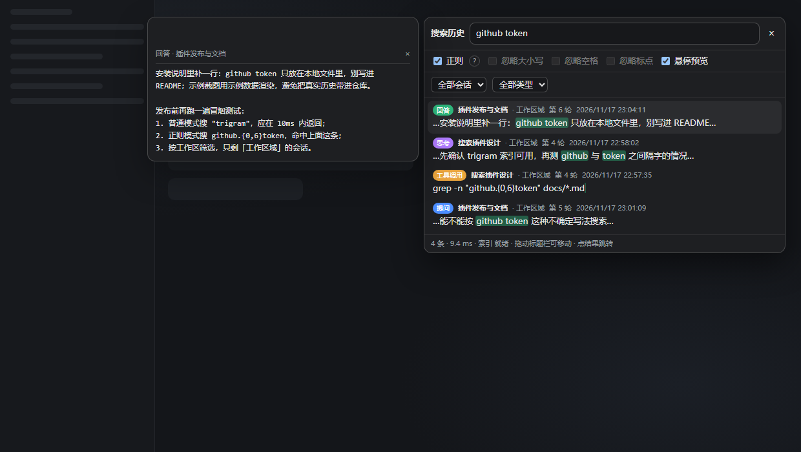

# dsh-history-search

给 DeepSeek Harness（DSH）加一个 **Ctrl+Shift+F 式的历史查找面板**：在所有本地会话里搜**提问 / 回答 / 思考 / 工具调用 / 工具结果**，支持正则与「忽略大小写/空格/标点」，可限定工作区、当前会话或最后一轮；命中标绿、悬停看全文，点击跳回那段对话。



> 上图是用示例数据渲染的界面示意（`docs/preview.html`），刻意不含真实会话内容。替换成你自己的实测截图：打开面板后 `Win+Shift+S` 截取，覆盖 `docs/preview.png` 即可。

## 为什么做

- DSH 侧栏的搜索只覆盖会话标题和提问，搜不到回答正文、思考和工具调用；
- 官方 `session-query-sqlite` 的全文索引**不含 reasoning**（`<thinking>` 那段），而且索引是搜索时惰性对账，停用几天后第一次搜索要补读大量 zstd 帧；
- 想在「三天前那个会话里，我是不是让 agent 查过 github 的 token」这种模糊记忆里找人，需要**变体匹配**：`github的token` / `github token` / `github 获取的 token` 应该一次搜到 —— 这正是正则和「忽略空格/标点」的用武之地。

## 功能

- **全文五类**：提问、回答、思考（从 `assistant/message.stream` 的 `reasoning-chunks` 抽取）、工具调用参数、工具结果；
- **两种模式**：普通（可叠加 忽略大小写 / 空格 / 标点）与**正则**（面板内 `?` 有符号速查）；
- **三种范围**：全部会话 / 按工作区 / 当前会话 / 当前会话最后一轮；
- **命中标绿**：宽松匹配时把被跳过的空格、标点一并标出；
- **悬停预览**：鼠标停在结果上，侧边浮出该段全文，可直接移过去滚动（自动选空间更大的一侧，可关闭）；
- **点击跳转**：打开会话 → `loadThrough(seq)` 确保那段已加载 → 在正文里定位并滚过去；失败会明确提示而不是静默；
- **增量索引**：每轮结束（`turn/end`）1.5s 防抖重建该会话；
- **可拖动**的浮窗，标题栏拖拽。

## 与社区同类插件的区别

DSH 生态里已经有几个方向相近的插件，选之前可以先对比：

| 插件 | 覆盖范围 | 变体匹配 | 说明 |
|---|---|---|---|
| [itstartstosnow/dsh-conversation-search](https://github.com/itstartstosnow/dsh-conversation-search) | 提问/回答，可选工具输出与思考 | 大小写、全词 | 侧栏全局搜索 + `Cmd/Ctrl+F` 页内查找 + 精确跳转，成熟度更高 |
| [dsh-plugin-transcript-search](https://github.com/deepseek-ai/deepseek-harness/discussions/1045) | 归档会话全文 | — | 偏检索归档 |
| DSH Memory Pro（原 dsh-memory-plus） | 中文检索、跨会话搜索、原文回读 | — | 更偏「记忆 + RAG」 |
| **本插件** | 提问/回答/思考/工具调用/工具结果 | **正则 + 忽略空格/标点** | 工作区范围、绿标、悬停预览、可拖动浮窗 |

结论：**不是唯一**，但「正则 + 忽略空格/标点 + 工作区范围 + 悬停全文预览」这组组合目前没见到同款。

## 安装

```powershell
dsh plugin --profile desktop add github:L-jh40/dsh-history-search
```

装完刷新页面（客户端 bundle 在页面加载时取）。首次挂载会在后台建索引（约 1 分钟，79 个会话 / 3.6 万条文档）。

## 性能（本机实测，36k 文档，128MB 页缓存 + mmap）

| 查询 | 耗时 |
|---|---|
| ≥3 字符（FTS5 trigram） | **2–8 ms** |
| 2 字中文（trigram 不适用，`instr` 扫描） | **85–125 ms** |
| 限定会话 / 最后一轮（`sid` 索引） | 25–31 ms |
| 正则（全表扫描） | ~2 s |

## 数据

- 索引：`%USERPROFILE%\.dsh\history-search\index.db`（可删，删了下次挂载重建）；
- 表：`docs(id, sid, seq, type, turn, time, cwd, text, norm)`、`docs_fts`（FTS5 trigram）、`sessions(sid, title, workspace, cwd, …)`；
- 匹配：粗筛（trigram / `instr`）→ 按请求模式精确后筛 → 原文定位出片段与高亮区间。

## HTTP 接口

```
GET /api/history-search?q=…&lower=1&space=0&punct=0&regex=0
    &scope=all|workspace|session|lastturn&sid=…&workspace=<cwd>&types=…&limit=100
GET /api/history-search?action=status|workspaces|reindex
```

## 已知限制

- **跳转依赖正文渲染**：目标消息尚未渲染时定位不到，会给出提示；预览仍可读全文。
- **2 字中文**用不上 trigram，全库扫描 85–125 ms。
- **正则模式**逐行扫全表，36k 文档约 2 s，无中断。
- 只索引 `listSessions()` 能列出的逻辑会话；旧格式代（v0/v1/v2）需先迁移。
- 索引结构版本变化时整库重建。

## License

MIT
